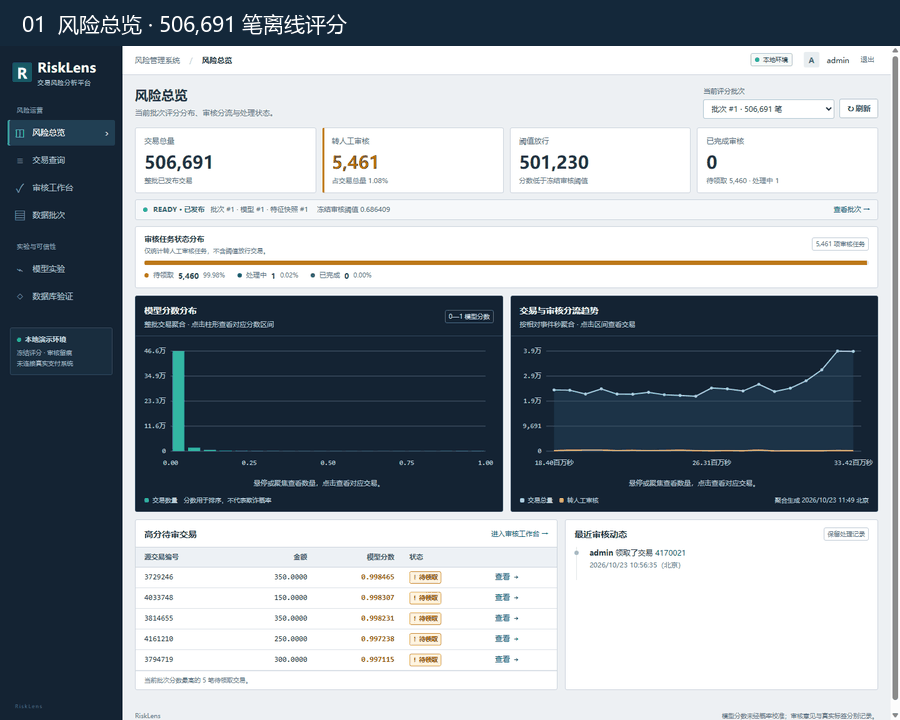
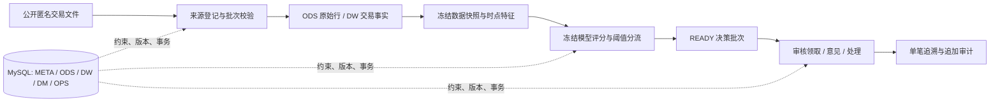
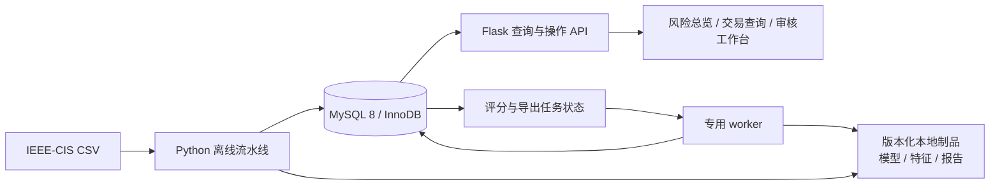
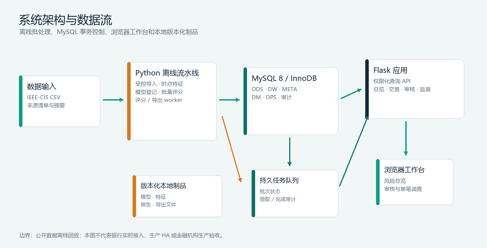

# RiskLens | 交易反欺诈分析平台

**把一笔交易，从数据来源、模型决策一直追到人工审核。** 这是一个以 MySQL 为核心的离线风控回放与审核平台：批次有清单，评分有版本，审核有事务，决策有血缘。




> **一分钟看懂结果：** IEEE-CIS 官方无标签测试集完成 **506,691** 笔离线评分；**5,461** 笔进入人工审核，**501,230** 笔按冻结阈值标记放行。测试集没有公开标签，因此不报告其准确率、AP 或召回率。

## Quick Start | 60 秒项目导览

展示仓库提供真实界面导览、功能模型、架构图和基准口径；**应用源码不在本仓库**。最快的评审路径：播放上方 GIF，阅读下面的架构与基准，然后进入[应用源码仓库](https://github.com/mutongsun/bistu-db-fraud-risk-platform)。

源码仓库的 Windows 开发环境入口：

```powershell
git clone https://github.com/mutongsun/bistu-db-fraud-risk-platform.git
cd bistu-db-fraud-risk-platform
conda env create -f environment.yml
conda activate fraudrisk
Copy-Item .env.example .env
```

以上命令准备 Python 环境和本地配置模板，不启动应用。随后按源码仓库的 `sql/README.md` 配置 MySQL 8、建立本地数据库并填好 `.env`；合法取得 IEEE-CIS 数据后再运行 `python scripts/preflight.py` 检查依赖。`preflight.py` 是环境检查，不是启动 Web 服务的命令。展示仓库中的基准来自 **2026-11-01 本机隔离工作区**；核心验收记录 `commit_bound=false`，因此这些结果不是应用源码公开 `main` 的 CI 结论。

## 系统闭环



| 设计抓手 | 实际机制 | 业务结果 |
| --- | --- | --- |
| 时点一致 | 历史特征只取严格早于当前事件秒的数据；同秒交易不互相进入历史 | 回放结果不读取未来交易行为 |
| 数据治理 | 来源命名空间、文件 SHA-256、处理幂等键、冻结 manifest 与成员复合外键 | 输入可核验，重复执行可控 |
| 决策追溯 | 每条决策绑定数据、特征、模型与评分批次；历史决策追加保存 | 能回答“用什么版本、基于什么输入” |
| 并发审核 | 告警行锁、`row_version`、请求幂等键、审核与审计同事务提交 | 并发领取只有一个状态赢家，冲突完整回滚 |

## 架构



**数据库承担控制面。** ODS、DW、META、DM、OPS 分别管理源行、事实、快照与版本、推理制品登记、评分决策和审核审计。完整模型与训练特征以本地版本化制品保存，MySQL 记录内容摘要和引用关系。



## MySQL Benchmark

2026-11-01 在 MySQL 8.0.39 临时实例测量：**1,000 条合成决策、单连接、每条查询 2 次预热和 9 次计时**；结果按顺序摘要核对，并记录 `EXPLAIN ANALYZE`。

| 查询路径 | p50 | p95 |
| --- | ---: | ---: |
| 总览：选中评分批次 | 0.518 ms | 0.640 ms |
| 总览：批次列表 | 0.335 ms | 0.571 ms |
| 分析：联合分桶 | 2.127 ms | 2.640 ms |
| 交易：事件排序首屏 / 下一页 | 1.894 / 1.862 ms | 2.127 / 2.114 ms |
| 交易：分数排序首屏 / 下一页 | 1.900 / 1.619 ms | 2.168 / 2.264 ms |

这些是**热缓存 SQL 执行与完整结果读取时间**，不含 HTTP、认证、网络、浏览器、并发或冷启动。样本用于比较查询路径，不构成生产 SLA、吞吐承诺或容量结论。

审核认领基准使用 1 / 2 / 4 / 8 个 worker、独立 MySQL 连接和屏障同步；8 worker 结果如下：

| 场景 | 尝试 / 成功 | 全部尝试 p50 / p95 | 成功认领吞吐 |
| --- | ---: | ---: | ---: |
| 认领不同告警 | 160 / 160 | 10.20 / 15.24 ms | 709.6 次/秒 |
| 竞争同一告警（8 轮） | 64 / 8，56 次版本冲突 | 5.83 / 9.16 ms | 109.0 次/秒 |

每轮同告警竞争恰有一个成功者；竞争场景的延迟分位数包含成功请求和冲突回滚。共 332 条告警完成状态、审核事件和审计事件对账。并发样本为本机合成工作负载，吞吐不是线上容量指标。

**写入代价对照：** 1,000 条决策发布，每方案交替顺序运行 3 次。保留三条非约束二级索引时 p50/p95 为 **160.52 / 229.85 ms**；移除后为 **116.65 / 205.78 ms**，结果摘要相同。样本量小且受缓存和执行次序影响，不能据此推断移除索引会提高整体性能；事件与分数排序查询的 `EXPLAIN ANALYZE` 验证对应索引避免了额外排序，action 索引的读计划未在本组对照中验证。

## 产品与模型口径

- **590,540 笔** IEEE-CIS 训练快照；官方 test **506,691 笔**无标签交易用于离线评分。
- 冻结静态 LightGBM 的 V-tune AP 为 **0.696136**；历史特征候选为 **0.684792**，没有胜过静态候选。项目不宣称时序特征提升模型效果。
- 已消费时间留出集 AP 为 **0.494315**；该窗口不用于反复调参。
- `model_score` 未校准，是排序分数，不是欺诈概率。`PASS` / `REVIEW` 是本地回放动作，不连接真实资金或支付网络。

## 本地验证记录

2026-11-01 隔离 MySQL 核心验收覆盖迁移重放、合成 train/test 导入、来源对账、批量评分、解释生成、审核并发和幂等重试；报告 `valid=true`。定向检查 **58 passed**，Ruff 通过。该验收来自当时未绑定提交的本机工作区；不代表全仓完整回归、公开 `main` CI、生产数据库或机构验收。

## 架构边界与文档

本项目交付的是**公开数据离线历史回放与人工审核工作台**。它不是已接入银行交易流的实时拦截服务。HA、KMS/HSM、跨主机对象存储、生产 RPO/RTO 和机构审批仍是目标架构与待验收事项。

- [企业部署与高可用目标架构](docs/Enterprise-Deployment-and-HA-Architecture.md)
- [应用源码仓库](https://github.com/mutongsun/bistu-db-fraud-risk-platform)
- [比赛初赛作品说明（Word）](docs/交易反欺诈分析平台_初赛作品说明.docx)
