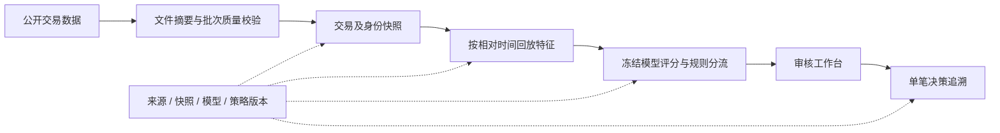

# 交易反欺诈分析平台

**数据库应用设计比赛项目。** 项目以 IEEE-CIS 公开匿名交易数据为主场景，完成离线导入、时点一致的特征回放、冻结模型评分、规则分流、人工审核与单笔决策追溯。核心问题是：一笔决策在当时依据哪些数据、模型和阈值作出，事后能否沿版本与批次还原。

> 本仓库是面向评委的公开项目介绍与架构设计文档。它不包含应用源代码、真实业务数据、运行密钥或生产部署配置。文中的历史验收数字对应各自记录的代码快照，不能充当当前工作区的完整回归结果。

## 一条可展示的业务链

主场景采用 MySQL 存储来源、快照、评分、审核与审计记录；Python 与 Flask 提供数据处理、任务执行及六模块工作台。PaySim 和 ULB 是独立基准方向，不与 IEEE-CIS 按交易 ID 拼接，也不代表已经接入银行实时交易。项目名称中的“时点一致”限定为评分时可见字段及严格早于当前秒的历史；原始匿名字段的生成时间并非全部可验证。

## 已有证据与口径

| 项目 | 已记录结果 | 应如何理解 |
| --- | --- | --- |
| IEEE-CIS 训练快照 | 590,540 笔交易 | 公开数据的本地离线快照，不是机构交易流量 |
| 官方无标签测试集评分 | 506,691 笔；其中 5,461 笔转人工审核 | 已发布批量决策；官方测试集无公开标签，不能计算它的准确率、AP 或召回率 |
| 冻结模型的时间留出评估 | AP 0.494315，ROC-AUC 0.871741 | 指官方 train 内部的已消费 holdout；不能反复据此调参或宣称后续模型改进 |
| 旧版全量自动化测试 | 2026-10-26 快照 1,055 passed；2026-10-27 较新快照 1,278 passed | 两份报告都早于后续开发增量；均不等于当前工作区已完成全量回归 |

数据库约束、不可变快照、版本引用和审核事务支撑原始决策回查。历史特征候选在已记录的开发对照中未优于静态候选，因此当前批量评分使用冻结的静态 LightGBM；`model_score` 未校准，不称作欺诈概率。

## 答辩展示顺序

1. 在总览页核对已发布批次与风险分流数量。
2. 打开交易列表与单笔详情，沿来源文件、快照、模型和策略版本追溯决策。
3. 展示人工审核的认领、意见和操作记录；明确审核意见不自动充当真实标签。
4. 在实验与数据库验证页展示时间切分、固定预算指标及与本次演示版本相符的验收报告。

演示范围是公开数据的历史回放。页面上的 `PASS` / `REVIEW` 是离线分流建议，不执行真实资金放行、拦截或扣款。CSV 导出、后台任务及高级治理能力按现场环境和对应验收报告展示，不将未复验功能写进演示承诺。

## 企业部署设计

[Enterprise Deployment & HA Architecture](docs/Enterprise-Deployment-and-HA-Architecture.md) 描述跨主机共享制品租约、密钥轮换、时间点恢复及故障演练的目标方案。文中的多节点、高可用和生产监控是待接入、待测量、待授权的设计，当前项目不宣称通过金融机构生产准入。

公开材料可以用于讨论架构与演示思路；实际部署还需数据许可、机构身份与职责、目标容量、安全评审、灾备指标和正式上线批准。项目尚未对外发布 `v1.0`，也没有已确认的企业内测计划。
