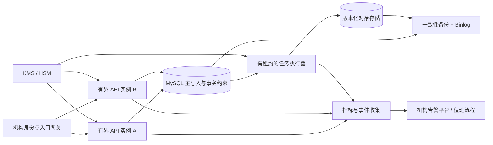
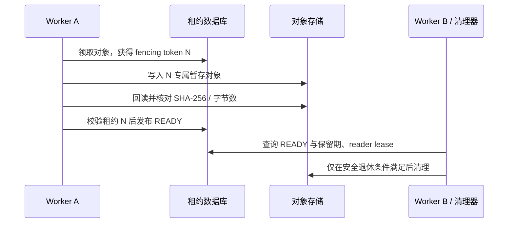

# Enterprise Deployment & HA Architecture

**状态：目标架构白皮书草案，非已部署系统说明。** 本文把公开数据离线演示与企业生产目标分开。当前有本地合成参考实现、顺序数据库迁移和部分隔离 MySQL 测试；目标机构的身份、密钥、对象存储、HA、真实流量与审批证据尚未提供。任何架构图都不能代替真实系统验收。

## 1. 目标边界与设计原则

企业部署要让交易决策同时满足三个约束：只使用决策时已经可用的数据，决策和后续审核能按版本重放，失败或切换后不产生重复处置。生产目标的延迟、吞吐、可用性、RPO 和 RTO 必须由目标机构定义，再在目标环境测量。

上图是**拟议拓扑**。当前仓库的本地脚本、合成在线参考服务、共享制品适配器及告警证据原型不构成该拓扑已经建成的证据；尤其不能从“两个 API 框”推断已通过双机故障切换。

## 2. 跨主机共享制品与租约

共享对象按 `organization_id`、制品类型、内容摘要和存储根身份登记。写入者先在数据库取得带单调递增 fencing token 的有期限租约，写入不可见暂存对象，读回并验证字节数与 SHA-256，再以事务将登记状态置为 `READY`。消费方仅读取 `READY` 且绑定相同摘要的对象；每次读取获取独立 reader lease，清理程序只在保留期限已到且没有有效 reader lease 时退休对象。

故障判定应覆盖写入者超时、旧 token 迟到提交、对象已写但数据库未发布、数据库已发布但对象不可读、读者断连、存储根变更、跨主机时钟偏差及长期清理积压。目标对象存储的条件写入、读后可见性、IAM 和命名空间隔离需要独立适配与验收。现有本地文件适配器或合成回归不能证明这些语义。

## 3. KMS 密钥轮换与敏感数据

目标方案采用机构批准的 KMS/HSM 作为密钥根。应用只持有短期身份与最小范围的解密权限，密钥版本和数据密文分别保存；日志、导出和备份使用同一字段分类及脱敏规则。轮换分四步：登记新版本，先让新写入使用它，再按受控批次重包或重加密旧对象，最后在确认无活动读者、合法保留与恢复需求后停用旧版本。每步都记录操作者、批准票据、对象范围、失败进度和回滚路径。

撤销密钥与合法保留、审计留存和 PITR 可能冲突，必须先确定机构政策。当前项目没有机构 KMS/HSM、真实 PII 分类或轮换验收；这里的流程只是接口和演练设计。

## 4. 一致性备份与 PITR

时间点恢复应选取一组有界、可核对的数据库快照和 binlog 水位，并把同一时点的不可变制品清单、对象摘要、密钥版本与迁移版本纳入恢复清单。演练在隔离环境中进行：恢复数据库到选定时间，重放到目标 binlog 位置，恢复对应制品，按清单核对行数、摘要与 READY 引用，最后执行只读的关键业务链探针。任何缺失对象或摘要不匹配都应使恢复验收失败。

演练至少覆盖单机崩溃、数据库主节点失效、对象缺失、密钥版本不可用、误删除、迁移中断及恢复后旧 worker 迟到写入。仓库中的本地 PITR 脚本和合成演练仅证明可执行的局部流程；跨故障域备份、生产容量下恢复时间和机构签认仍待提供。

## 5. 上线前验收矩阵

| 门槛 | 必要证据 | 责任方 |
| --- | --- | --- |
| 业务与模型准入 | 真实交易动作、误报代价、模型用途、独立未消费数据评估与签认 | 机构业务、模型风险与授权人 |
| 数据与隐私准入 | 数据语义、来源许可、PII 分类、保留删除政策、密钥策略 | 数据拥有方、法务、隐私和安全 |
| 容量与灾备准入 | 目标负载下的 p95/p99、长稳、切换、PITR、RPO/RTO | 目标环境运维与业务连续性负责人 |
| 监控与运行准入 | 告警送达、值班响应、权限撤销、故障复盘记录 | 运维、安全与值班团队 |
| 正式上线批准 | 独立审批票据、变更窗口、回滚演练、签署记录 | 机构授权审批人 |

本白皮书不赋予任何一项门槛“已通过”状态。项目可以展示离线回放与局部合成验证，但不能把它描述为已获金融机构生产验收的实时风控系统。
